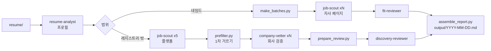

# job-fit-harness

이력서를 넣으면 연차와 직무에 맞는 채용공고를 찾아 마크다운 리포트 한 장으로 정리하는 Claude Code 하네스입니다. 개발 직군뿐 아니라 기획, 디자인, 데이터 분석, 마케팅, 영업 같은 직군 이력서도 다룹니다.

## 사용법

1. `resume/` 폴더에 이력서를 넣습니다. PDF와 md, txt, docx를 읽습니다.
2. Claude Code를 Chrome 연동과 함께 켭니다. Cloudflare에 막히는 사이트(잡플래닛, 넥슨)와 JS로만 그려지는 채용 페이지를 읽을 때 씁니다. 연동 없이 켜도 그 몫만 빠지고 나머지는 동작합니다.
   ```bash
   claude --chrome
   ```
3. 요청합니다.
   ```
   채용공고 찾아줘
   ```
4. 범위를 고릅니다. 첫 화면에서 "전부", "네임드 기업만", "레지스트리 밖만", "직접 고르기" 중 하나를 고릅니다. "직접 고르기"를 고르면 아래 여섯 범위를 하나씩 고르는 화면이 뜹니다.

결과는 `output/YYYY-MM-DD.md`에 저장됩니다.

## 범위

| 질문               | 범위                                                          | 찾는 방법                                                                                  |
| ------------------ | ------------------------------------------------------------- | ------------------------------------------------------------------------------------------ |
| 네임드 기업        | 빅테크: 네카라쿠배당토직야, 몰두센과 계열사                   | `data/companies.md`에 등록된 회사를 자사 채용 페이지로 정확하게 읽습니다                   |
|                    | 대기업 계열사: 삼성, LG, SK, 현대차, CJ, 금융그룹 IT 등       |                                                                                            |
|                    | 유니콘과 네임밸류: 무신사, 컬리, 오늘의집, 게임사, 중견 IT 등 |                                                                                            |
| 레지스트리 밖 회사 | 성장 스타트업: 시리즈 B 이상                                  | 채용 플랫폼 전체에서 넓게 찾고, 회사를 검증해 괜찮은 곳만 남깁니다. 1시간 남짓 더 걸립니다 |
|                    | 초기 스타트업: 시드부터 시리즈 A                              |                                                                                            |
|                    | 상장사와 중견, 중소: 투자 이력이 확인되지 않는 회사           |                                                                                            |

두 질문의 범위는 겹치지 않습니다. 레지스트리에 있는 회사는 네임드 범위로만, 없는 회사는 레지스트리 밖 범위로만 나옵니다. 경력이 짧아 네임드 기업 요건(대개 3년 이상)에 잘 안 맞으면 레지스트리 밖 범위를 함께 고르세요.

범위를 매번 고르지 않아도 되는 경우가 있습니다.

- 요청에 범위가 드러나면 바로 찾습니다. "네카라쿠배만 찾아줘", "대기업 공고 찾아줘", "숨은 회사 찾아줘", "스타트업 위주로", "시리즈 A 회사", "전부 찾아줘".
- "다시 찾아줘"처럼 범위 말이 없는 재실행은 지난번 범위를 그대로 씁니다.
- `resume/preferences.md`에 `범위:` 줄을 적어 두면 늘 그 범위로 찾습니다.

후속 요청도 같은 하네스가 받습니다. "토스만 다시", "원티드만 다시", "회사 검증만 다시", "리포트만 다시 써줘", "이력서 바꿨어 다시 돌려줘"처럼 말하면 필요한 단계만 다시 돌립니다.

### 희망 조건 (선택)

이력서만으로 정할 수 없는 조건은 `resume/preferences.md`에 적습니다. 형식은 자유이고 이력서보다 우선합니다.

```markdown
- 범위: 빅테크, 유니콘과 네임밸류, 성장 스타트업
- 희망 직무: 프론트엔드, 웹 플랫폼
- 인접 직무: 풀스택
- 연차: 5년 (이력서 계산값 대신 이 값을 쓴다)
- 준하는 경력: 포함 ("5년 이상 또는 동등 역량" 공고를 연차가 모자라도 검토로 남긴다)
- 근무지: 서울, 판교
- 제외: 현 직장, SI 성격 포지션
- 추가로 볼 기업: 리벨리온
```

## 동작 방식



두 흐름은 한 번에 시작해 병렬로 돕니다. 레지스트리 밖 회사를 검증하는 동안 네임드 판정을 먼저 끝냅니다.

| 단계               | 담당                                 | 하는 일                                                                                                                                                    |
| ------------------ | ------------------------------------ | ---------------------------------------------------------------------------------------------------------------------------------------------------------- |
| 프로필             | `resume-analyst`                     | 이력서에서 직무군과 경력 연수, 핵심 역량, 검색어를 뽑습니다. 이름과 연락처는 옮기지 않습니다                                                               |
| 네임드 수집        | `job-scout` 여러 개                  | 고른 범위의 레지스트리 회사를 17곳 안팎씩 나눠 자사 채용 페이지를 읽습니다                                                                                 |
| 레지스트리 밖 수집 | `job-scout` 5개                      | 원티드, 리멤버, 점핏, 랠릿, 사람인, 잡코리아, 직행, 캐치, 링크드인과 ATS 검색을 플랫폼별로 나눠 읽습니다. 직무 코드로 검색하고 플랫폼당 300건까지 받습니다 |
| 브라우저           | `browser-scout` 한 개                | Chrome이 필요한 곳(넥슨, 잡플래닛, JS로만 그려지는 페이지)을 읽습니다                                                                                      |
| 1차 거르기         | `prefilter.py`                       | 레지스트리 기업과 제외 기업, 헤드헌팅, 계약직, 마감 지난 공고, 연차 범위 밖, 직무가 분명히 다른 공고를 뺍니다                                              |
| 회사 검증          | `company-vetter` 여러 개             | 레지스트리 밖 회사의 등급을 매깁니다(아래 표)                                                                                                              |
| 판정               | `fit-reviewer`, `discovery-reviewer` | 연차와 직무, 역량으로 추천과 검토를 나눕니다                                                                                                               |
| 합치기             | `assemble_report.py`                 | 두 절을 리포트 한 장으로 합칩니다                                                                                                                          |

Chrome 작업을 에이전트 하나에 몰아 둔 이유는 브라우저 하나를 여러 에이전트가 동시에 조작하면 탭 포커스와 스크린샷이 서로 엉키기 때문입니다. `job-scout`는 Chrome 도구를 아예 받지 않습니다.

### 회사 검증

레지스트리 밖 회사는 공개 출처로 검증합니다. 1차로 국민연금 가입 사업장 공공데이터에서 직원 수와 1년 증감을, 뉴스에서 폐업과 회생, 체불 보도를 봅니다. 통과한 회사만 2차로 투자 단계와 매출, 직원 평점, 지원 직무 조직 근거(개발이면 기술 블로그와 GitHub, 디자인이면 디자인 시스템이나 포트폴리오, 그 밖이면 공고의 팀 구성과 구체적 업무)를 봅니다.

| 등급    | 뜻                                                                                   | 리포트     |
| ------- | ------------------------------------------------------------------------------------ | ---------- |
| A       | 추천할 만함. 자금이나 수익 근거, 직원 증가, 직무 조직 근거가 있고 레드 플래그가 없다 | 추천, 검토 |
| B       | 무난함. 레드 플래그는 없고 근거가 일부만 있다                                        | 추천, 검토 |
| C       | 주의. 직원 급감이나 낮은 평점 같은 약한 레드 플래그가 있다                           | 검토만     |
| X       | 제외. 폐업, 회생, 체불 같은 강한 레드 플래그가 있거나 파견, SI 상주가 주력이다       | 뺀다       |
| unknown | 근거가 거의 없거나 같은 이름의 회사를 가려내지 못했다                                | 뺀다       |

검증 결과의 투자 단계로 성장 스타트업, 초기 스타트업, 상장사와 중견, 중소를 나눕니다. 결과는 `_cache/vetting.json`에 30일 동안 남아서 다음 실행 때 같은 회사를 다시 조사하지 않습니다. 한 번에 검증하는 회사는 직무가 잘 맞는 순서로 120곳까지입니다.

## 결과물

리포트에는 지원 판단에 필요한 것만 넣습니다.

```markdown
# 채용공고 2026-10-12

프론트엔드 경력 5년 기준. 범위: 빅테크, 성장 스타트업. 공고 9건 (신규 3건)

추천은 직무와 연차, 역량이 모두 맞는 공고이고 검토는 그중 하나가 경계에 걸려 직접 확인해 볼 공고다. 티어는 ... 등급은 ...

## 네임드 기업

범위: 빅테크. 기업 38곳 확인, 공고 6건 (신규 1건)

### 추천

| 티어 | 기업 | 포지션                               | 경력     | 마감 | 맞는 이유              | 링크                |
| ---- | ---- | ------------------------------------ | -------- | ---- | ---------------------- | ------------------- |
| S    | 쿠팡 | 신규 Senior Front-end Engineer (Ads) | 5년 이상 | 상시 | React, TS, 광고 도메인 | [자사](https://...) |

### 확인 못 한 곳

넥슨 (Chrome 미연결)

## 레지스트리 밖 회사

범위: 성장 스타트업. 회사 42곳 검증, 공고 3건 (신규 2건)

### 추천

| 등급 | 기업     | 회사 근거                         | 포지션                 | 경력   | 마감 | 맞는 이유          | 링크                  |
| ---- | -------- | --------------------------------- | ---------------------- | ------ | ---- | ------------------ | --------------------- |
| A    | 아이벡스 | 시리즈C(2024-08), 직원 91명(+21%) | 신규 Frontend Engineer | 5~11년 | 상시 | React, TS, Zustand | [원티드](https://...) |
```

- **추천**: 직무가 맞고 연차가 요건 안에 있으며 핵심 역량이 두 개 이상 겹칩니다.
- **검토**: 직무가 인접하거나 연차가 요건 경계에 있습니다. 무엇이 걸리는지 적습니다.
- **신규**: 직전 리포트에 없던 공고입니다.
- **티어**: 네임드 기업의 지원 우선순위입니다. `data/companies.md`에서 정합니다.

같은 공고가 여러 곳에 올라와 있으면 자사 채용 페이지, 원티드, 리멤버, 잡플래닛, 사람인, 직행, 점핏, 잡코리아, 캐치, 랠릿, 링크드인 순서로 앞선 출처의 링크를 씁니다.

다음 공고는 리포트에 넣지 않습니다.

- 헤드헌팅이나 서치펌 공고, 회사명을 가린 공고
- 파견, 도급, 고객사 상주 근무
- 계약직, 인턴, 아르바이트, 프리랜서. `preferences.md`에 허용한다고 적으면 남깁니다
- 레지스트리 밖 회사 중 등급이 X나 unknown인 곳

제외한 공고와 이유는 `_workspace/04_dropped.md`(네임드)와 `_discover/05_dropped.md`(레지스트리 밖)에 남습니다. 원하는 공고가 빠졌으면 여기서 이유를 확인하세요.

## 폴더 구조

```
job-fit-harness/
├── README.md
├── CLAUDE.md                      하네스 트리거
├── .claude/
│   ├── settings.json              웹 검색, 웹 읽기, curl, Chrome 권한
│   ├── agents/
│   │   ├── resume-analyst.md
│   │   ├── job-scout.md
│   │   ├── browser-scout.md
│   │   ├── company-vetter.md
│   │   ├── fit-reviewer.md
│   │   └── discovery-reviewer.md
│   └── skills/
│       ├── job-hunt/              오케스트레이터와 scripts/
│       ├── resume-profiling/      이력서에서 프로필 뽑는 법
│       ├── job-collection/        출처별 공고 수집법
│       │   └── references/        자사 페이지 읽는 법, 플랫폼 읽는 법과 직무 코드표
│       ├── company-vetting/       회사 검증 기준과 출처
│       ├── fit-report/            네임드 기업 절의 판정 기준과 형식
│       └── discovery-report/      레지스트리 밖 회사 절의 형식
├── data/
│   └── companies.md               기업 레지스트리
├── resume/                        이력서 (git 제외)
├── output/                        리포트 (git 제외)
├── _workspace/                    프로필, 범위, 네임드 흐름 중간 산출물 (git 제외)
├── _discover/                     레지스트리 밖 흐름 중간 산출물 (git 제외)
└── _cache/                        회사 검증 캐시, 국민연금 파일 (git 제외)
```

`.claude/agents/`는 누가 하는지, `.claude/skills/`는 어떻게 하는지를 담습니다. 에이전트는 작업을 시작할 때 자기 스킬 파일을 읽습니다. `scripts/`의 스크립트는 `python3 -I .claude/skills/job-hunt/scripts/test_scripts.py`와 `test_orchestration.py`로 확인합니다.

## 기업 레지스트리

`data/companies.md`의 절이 네임드 범위와 같습니다(빅테크, 대기업 계열사, 유니콘과 네임밸류). 회사를 다른 범위로 옮기려면 행을 다른 절로 옮깁니다. 같은 절 안에서는 `티어` 열 순서(S, A+, A, B+, B, 빈칸)로 정렬합니다.

| 열          | 뜻                                                                                                                                                               |
| ----------- | ---------------------------------------------------------------------------------------------------------------------------------------------------------------- |
| 티어        | 지원 우선순위. 비워 두면 맨 뒤로 갑니다                                                                                                                          |
| 채용 페이지 | 공고 목록이 보이는 URL                                                                                                                                           |
| ATS         | 자체, greetinghr, ninehire, lever, greenhouse 등                                                                                                                 |
| 접근        | `fetch`는 HTML에 공고가 있음, `api`는 공개 JSON이 있음, `browser`는 JS 렌더링이 필요함, `login`은 로그인이 필요함, `group`은 그룹 통합 사이트 행에서 함께 수집함 |
| 비고        | 수집에 쓰는 식별자와 거르는 조건                                                                                                                                 |

기업을 추가할 때는 이름과 채용 페이지만 적어도 됩니다. 접근 방식을 비워 두면 `job-scout`가 먼저 시도하고 안 되면 `browser-scout`로 넘깁니다. 수집 중에 바뀐 URL을 발견하거나, 레지스트리 밖에서 A등급 회사가 반복해서 나오면 실행이 끝날 때 레지스트리 수정을 제안합니다. 승인한 것만 반영합니다.

회생이나 파산, 합병으로 뺀 기업은 맨 아래 "제외한 기업" 절에 이유와 확인일을 남깁니다. 이 절은 수집 대상이 아니고, 플랫폼에서 이 기업 공고가 나와도 뺍니다.

## MCP

추가 MCP 서버 없이 동작합니다. `.mcp.json`도 두지 않았습니다.

- 웹 검색과 페이지 읽기는 Claude Code 내장 `WebSearch`, `WebFetch`를 씁니다.
- 공개 JSON API는 `curl`과 `jq`로 읽습니다.
- 브라우저는 Claude in Chrome 확장을 씁니다. MCP 설정 파일이 아니라 `claude --chrome` 또는 세션 안의 `/chrome`으로 켭니다.

Chrome 없이 무인으로 돌리면서 browser-scout 몫까지 읽어야 할 때만 Playwright MCP(`@playwright/mcp`)를 추가하면 됩니다.

## 주의

- 이력서와 리포트, 중간 산출물, 캐시는 `.gitignore`로 커밋에서 빠집니다. 리포트를 저장소에 남기려면 `.gitignore`에서 `output/`을 지우세요.
- `_cache/nps/`에는 국민연금 가입 사업장 파일 두 개(각 115MB 안팎)가 들어갑니다. 공공데이터포털의 이용허락 제한 없음 파일이고, 달이 바뀌면 새 판을 받습니다.
- `browser-scout`는 내 Chrome으로 접속합니다. 짧은 시간에 많은 페이지를 열지 않도록 페이지를 순서대로 하나씩 엽니다.
- THE VC는 페이지에 무단 사용과 DB화 금지 문구가 있어 검색 결과 요약만 근거로 씁니다.
- 공고는 수집 시점 기준입니다. 지원 전에 링크에서 마감 여부를 확인하세요.
